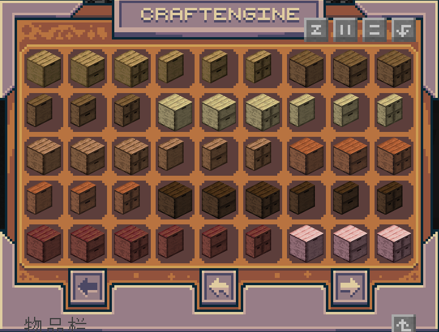
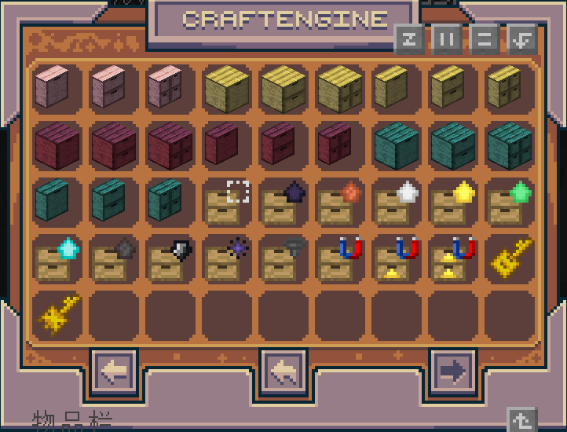
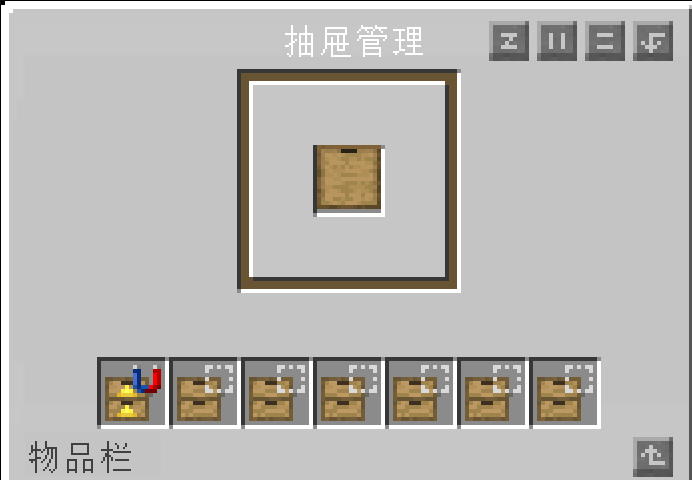
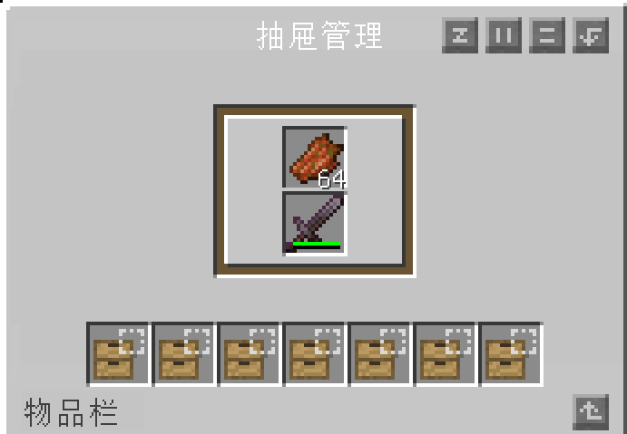
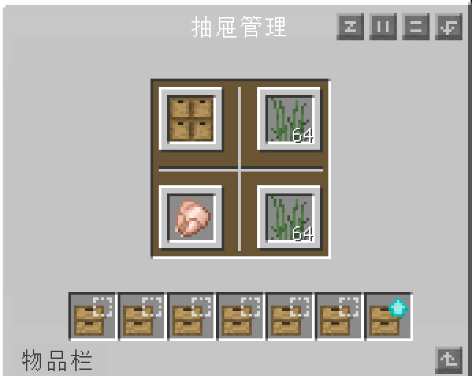

<div align="center">

<h1>🗄️ CraftDrawers</h1>

<p><strong>面向 Paper 服务器的储物抽屉插件</strong></p>
<p>🧱 66 种抽屉 · 🖼️ 物品与数量展示 · 🧰 独立管理界面 · 💾 SQLite 本地存储</p>

</div>

## ✨ 功能特性

| 功能 | 使用体验 |
| --- | --- |
| 🧱 66 种抽屉 | 11 种木材，搭配全深 / 半深外形与 1 / 2 / 4 仓位布局。 |
| 🖱️ 正面直接存取 | 左键取一个、潜行左键取一组、右键存入手持物品，按准星指向选择仓位。 |
| 🖼️ 仓内物品展示 | 通过物品展示实体和文本展示实体，在抽屉正面显示物品图标与库存数量。 |
| 📐 半深贴墙布局 | 使用 CE 家具模型与半深碰撞；放置时沿玩家水平视线方向靠向后半格。 |
| 🧰 一体化管理 GUI | 每种仓位数量各有独立 YAML，在同一界面查看库存并管理七个升级槽。 |
| 🔑 类型锁与私人抽屉 | 使用抽屉钥匙保留仓位类型，使用私人钥匙认领抽屉，限制其他玩家操作。 |
| 🧲 漏斗与磁铁 | 支持相邻漏斗输入、下方漏斗输出，以及磁铁升级收集附近掉落物。 |
| 🗄️ 合成配方 | CE资源包自带抽屉物品合成表，无须手动配置合成表 |

木材包括：橡木、云杉、白桦、丛林木、金合欢、深色橡木、红树、樱花木、竹材、绯红菌柄和诡异菌柄。

## 🖼️ 游戏内展示

### 🧱 抽屉与升级分类

多种木材、全深与半深造型，以及不同仓位布局，集中展示在 CraftEngine 物品分类中。



容量升级、磁铁、钥匙与其他工具，可在同一分类中浏览。



### 🧰 三种独立管理界面

单仓、双仓、四仓分别使用独立界面配置，每种界面都将仓内物品和七个升级槽放在同一窗口中。

| 📦 单仓位 | 🗂️ 双仓位 | 🗃️ 四仓位 |
| :---: | :---: | :---: |
| <a href="docs/images/gui-single-slot.png"></a> | <a href="docs/images/gui-two-slots.png"></a> | <a href="docs/images/gui-four-slots.png"></a> |

## 🚀 快速开始

### 环境要求

| 项目 | 当前要求 |
| --- | --- |
| 服务端 | 最低适配目标为 **Paper 1.21**；不同服务端小版本的兼容性以实际适配情况为准。 |
| Java | Java 21 或以上，并满足所选 Paper 与 CraftEngine 版本的运行要求。 |
| CraftEngine | **硬依赖 26.9.2** |

## 📦 容量与升级

### 基础容量

容量按**每个仓位**计算，以下数据不包含升级。「一组」取该物品自身的最大堆叠数，未必是 64。

| 仓位数 | 全深：每仓组数 | 半深：每仓组数 | 以 64 堆叠物品为例，全深 / 半深每仓数量 |
| --- | --- | --- | --- |
| 1 仓 | 32 组 | 16 组 | 2,048 / 1,024 |
| 2 仓 | 16 组 | 8 组 | 1,024 / 512 |
| 4 仓 | 8 组 | 4 组 | 512 / 256 |

### 七个升级槽

每个抽屉有七个升级槽。在 GUI 中，先左键玩家背包里的升级将其放到光标，再左键目标升级槽安装；光标为空时左键已安装槽，可卸下并取回升级。

| 升级 | 当前作用 |
| --- | --- |
| 容量升级 | 黑曜石、铜、铁、金、绿宝石、钻石、下界合金七种，可在多个槽位叠加安装。 |
| 单组升级 | 将每个仓位容量限制为该物品的一组，优先于容量升级计算。 |
| 虚空升级 | 手动右键存入时消耗本次手持堆叠中超出容量的部分；不会让漏斗或磁铁销毁溢出物品。 |
| 磁铁 I / II / III | 收集附近可存入的掉落物，等级越高收集范围越大；同一抽屉只允许安装一个磁铁升级。 |
| 漏斗升级 | 当前提供物品与配方，可作为一级磁铁的合成材料；现有漏斗搬运逻辑不以它作为启用条件。 |

单组、虚空、漏斗升级各最多安装一个；磁铁三个等级属于同一互斥类别。容量升级可重复安装，占用各自的升级槽。

当前容量公式为：

```text
每仓容量 = 物品最大堆叠数 × 基础组数 × (1 + 已安装容量升级系数之和)
```

黑曜石、铜、铁、金、绿宝石、钻石、下界合金的系数分别为 `2 / 4 / 8 / 16 / 64 / 256 / 2048`。例如只安装一个系数为 2 的容量升级时，当前实现的最终容量为基础容量的 **3 倍**；该计算包含基础容量本身。

### 漏斗搬运

- 将漏斗出口朝向抽屉所在方块格，可将物品输入抽屉。
- 在抽屉正下方放置漏斗，可将仓内物品输出。
- 自动搬运受仓位类型、剩余容量和漏斗冷却限制；普通漏斗搬运无需先安装漏斗升级。

私人抽屉的所有权校验针对玩家交互；当前漏斗与磁铁搬运路径不检查所有者身份。

## ⌨️ 命令与权限

| 命令 | 用途 | 权限与执行者 |
| --- | --- | --- |
| `/drawers` | 查看插件与 Minecraft 版本。 | 无额外权限检查；玩家或控制台。 |
| `/drawers version` | 同上。 | 无额外权限检查；玩家或控制台。 |
| `/drawers reload` | 重载语言与三个 GUI 配置，并关闭已有管理界面。 | `craftdrawers.admin`；玩家或控制台。 |
| `/drawers give <物品ID> [数量]` | 将 CE 物品给予命令执行者；数量默认 1，可指定 1–64。 | `craftdrawers.admin`；必须由玩家在游戏内执行。 |

## 🧪 Test 版性能压测

仓库附有独立 Test 版压测说明。Test 版只用于专用测试服务器，会增加夹具生成、SQLite / 展示更新循环与清理命令；请勿用于正式服务器。

详见 [STRESS-TEST.md](STRESS-TEST.md)。

## 💎 购买与授权

**CraftDrawers 为开源付费插件** 
**购买后默认您遵守以下条例**
**不得倒卖与传播插件**

配套包中的第三方素材保留各自的版权与许可声明；素材随附的 MIT 许可不代表 CraftDrawers 插件代码采用开源许可
